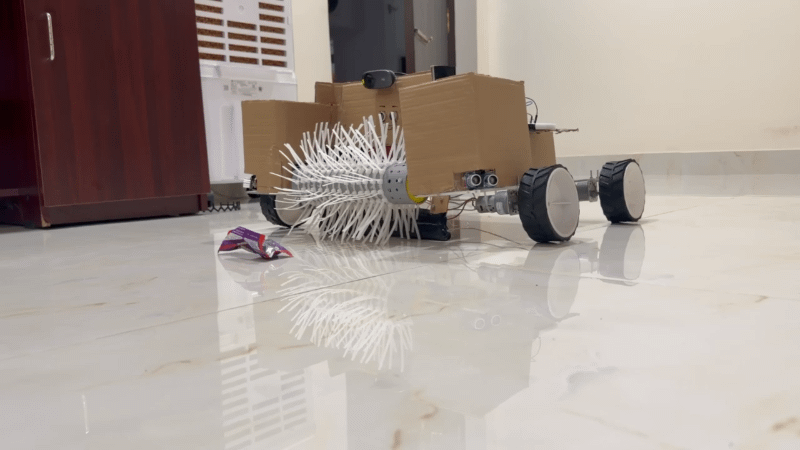
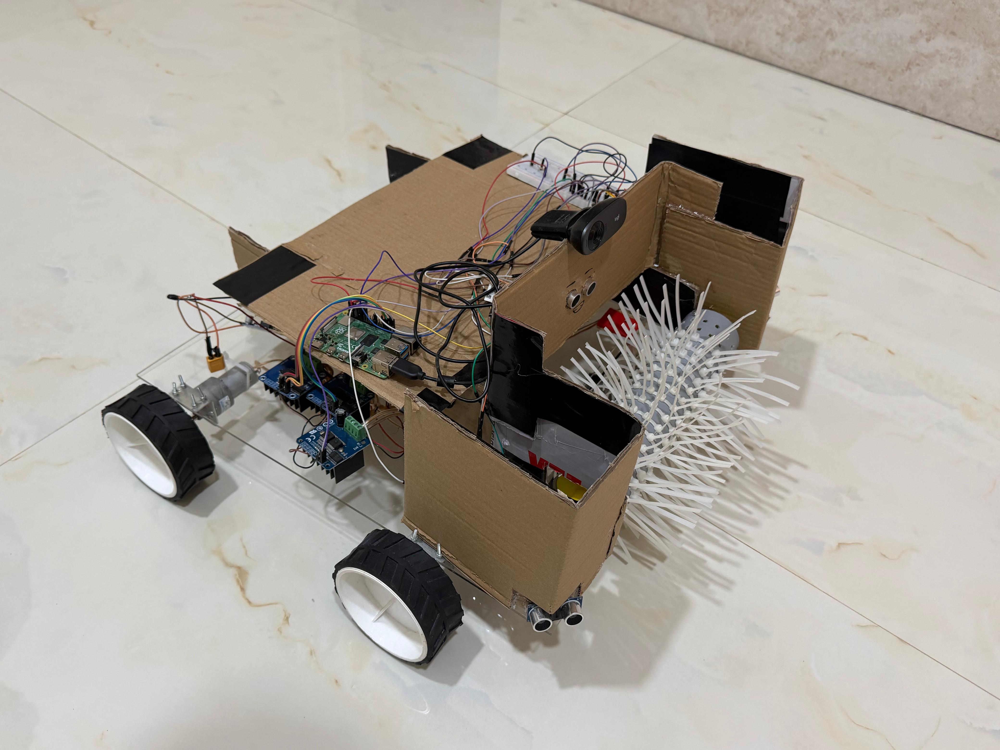
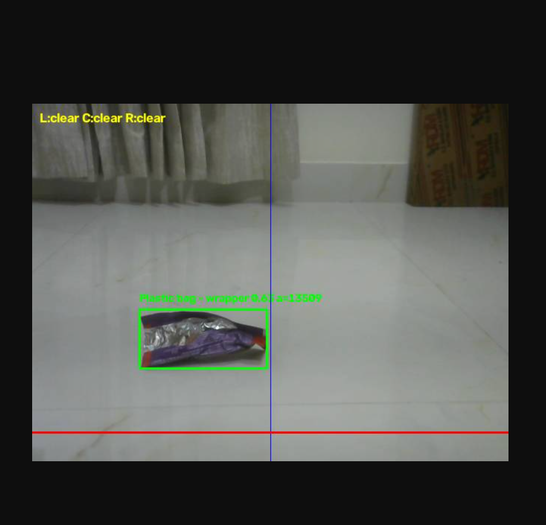

# Autonomous Trash-Picking Robot



A four-wheeled robot that finds plastic litter with a webcam, drives toward it, and picks it up with a handmade PVC gripper. A Raspberry Pi 4B runs everything on its CPU: YOLOv8n detection, three HC-SR04 ultrasonic sensors, and motor control through three BTS7960 drivers.

Demo video: https://youtu.be/uc-HQsVwEf8



## How it works

The control code in `src/main.py` runs three parts at once.

- **Vision thread.** Each webcam frame is resized to 416 px and passed through a YOLOv8n model fine-tuned on the TACO litter dataset, at about 2.4 FPS on the Pi's CPU. Of the detections in six target classes (Other plastic, Plastic bag - wrapper, Plastic container, Unlabeled litter, Other litter, Paper), it keeps the one with the largest bounding box.
- **Sensor thread.** Three ultrasonic sensors are polled in turn with a 40 ms gap to limit crosstalk. Each reported distance is the median of the last six readings, and a sensor reports "clear" until at least four are valid.
- **Main loop.** Each cycle follows this priority order:

1. **Avoid obstacles.** If a side sensor reads 20 cm or less, or the center sensor reads 20 cm or less, the robot reverses briefly and turns away. A cooldown of one second prevents repeated maneuvers.
2. **Pick up.** If the target is centered (x between 220 and 420 px), its box area is at least 65,000 px², and its bottom edge has reached the red line near the bottom of the frame, the robot drives forward for 2 seconds while the picker runs for 5, then backs up slightly.
3. **Approach.** Otherwise the robot turns toward a target outside the center band, or drives forward if it is centered.
4. **Catch a lost target.** The camera cannot see items directly under it. If a target was seen within the last 2.8 seconds and has just left the bottom of the frame, the picker runs anyway.
5. **Search.** With no target, the robot creeps forward at low speed.

The ultrasonic sensors never trigger the picker. They sit above the floor and cannot see small items on the ground, so they are used for obstacle avoidance only. A Flask server streams the annotated camera feed, with boxes, center line, pickup line and sensor readings, at `http://<pi-ip>:5000/video`.

## Hardware

| Component | Qty | Role |
|:---|:---:|:---|
| Raspberry Pi 4B | 1 | Controller |
| DC motors | 5 | 4 drive, 1 picker |
| BTS7960 motor drivers | 3 | Left side, right side, picker |
| HC-SR04 ultrasonic sensors | 3 | Left, center and right ranging |
| USB webcam | 1 | Detection |
| Acrylic sheet, cardboard, PVC pipe, zip ties | n/a | Chassis and gripper |

Pin map: [docs/wiring.md](docs/wiring.md). Parts and cost: [docs/bill_of_materials.md](docs/bill_of_materials.md). Gripper: [hardware/picker_design_notes.md](hardware/picker_design_notes.md).

## Repository layout

| Path | Contents |
|:---|:---|
| `src/main.py` | Control loop, detection, web stream |
| `src/ultrasonic.py` | HC-SR04 driver |
| `tests/` | Manual bring-up scripts (not a pytest suite) |
| `docs/` | Wiring, parts list, build notes, media |
| `hardware/` | Gripper design notes |

## Setup

On Raspberry Pi OS:

```
git clone https://github.com/sadbanana303/autonomous-trash-picking-robot.git
cd autonomous-trash-picking-robot
python3 -m venv --system-site-packages ~/robot-env
source ~/robot-env/bin/activate
pip install ultralytics flask
```

The trained weights (`best.pt`) are attached to the v1.0 release. Download them and set `MODEL_PATH` at the top of `src/main.py` to the file's location.

The scripts in `tests/` drive the hardware, so run them with the wheels off the ground, one subsystem at a time:

```
python tests/test_motors.py
python tests/test_picker.py
python tests/test_ultrasonic.py
python tests/test_cam_detection.py
python src/main.py picker
python src/main.py

```
Running main.py with the argument picker spins the picker for 5 seconds and exits, which tests the gripper alone.

Stop `main.py` with Ctrl+C. It stops the motors and releases the GPIO pins on exit.

## Results

### Detection model

YOLOv8n fine-tuned on the TACO dataset (18 classes), validated on 901 images.

| Metric | Value |
|:---|:---:|
| mAP50 | 0.686 |
| mAP50-95 | 0.521 |
| Precision | 0.837 |
| Recall | 0.624 |

Per-class results for the four target classes:

| Class | mAP50 | Note |
|:---|:---:|:---|
| Plastic container | 0.91 | Strongest |
| Plastic bag - wrapper | 0.81 | Strong |
| Other plastic | 0.52 | Weaker |
| Unlabeled litter | 0.39 | Weakest, recall 0.23 |

### On-device performance

| Item | Value |
|:---|:---|
| Hardware | Raspberry Pi 4B, CPU only |
| Input size | 416 px |
| Frame rate | 2.4 FPS |
| Stream | Choppy but usable |

### End-to-end pickup test

| Attempts | Successes | Success rate | Conditions |
|:---:|:---:|:---:|:---|
| 5 | 4 | 80% | Plastic wrappers, plain floor, good light |



## Limitations

- Detection is least reliable for clear or dark plastic and for small, distant items.
- The low frame rate means the robot reacts slowly, and it acts on the last detection for up to 1.4 seconds.
- The ultrasonic sensors sit above the floor. A target very close to the robot can read as an obstacle at 20 cm or less, so the robot may back away instead of picking it up.
- The robot has no map. Searching is a slow forward creep.
- Results come from a small test (5 attempts), not a controlled benchmark.
- The video stream has no authentication, so anyone on the same network can view it.

## Future work

- Run the model on an accelerator or export it to a faster runtime to raise the frame rate.
- Ignore the center sensor when a centered target is close, so nearby trash is not treated as an obstacle.
- Replace the forward creep with a real search pattern.

## Authors

Nandana Narendra (https://www.linkedin.com/in/nandana-narendra-115450398/) and Giri Pranesh K (https://www.linkedin.com/in/giri-pranesh-b10448230/)

Released under the MIT License.
