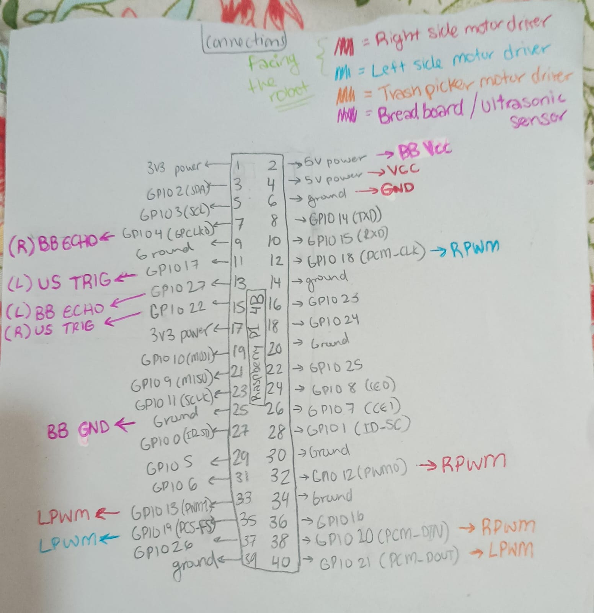

# Wiring

*Hand-drawn Raspberry Pi 4B pin map. The drawing is labeled as seen facing the robot, so its left and right are mirrored relative to the robot's own sides. The tables below use the robot's own left and right, as in `src/main.py`. The center ultrasonic sensor is not on the drawing and is listed in the sensor table.*

All pin numbers in the tables are BOARD (physical) numbers.

## Power

| Supply | Powers | Notes |
|:---|:---|:---|
| 11.1 V, 2200 mAh LiPo (3S) | Input to the buck converter | Motor power only |
| Buck converter, set to 12V | The motor supply terminals (B+ and B-) of the three BTS7960 drivers | Steps the battery voltage down to the motors' rated voltage |
| 5 V, 3 A USB-C supply | Raspberry Pi 4B | Separate from the motor battery |

The Pi's ground (pin 6) is shared with the driver logic ground, so the Pi and the drivers have a common reference. The Pi does not run from the motor battery, which keeps motor current spikes off its supply.

The Pi's ground (pin 6) is shared with the driver logic ground, so the Pi and the drivers have a common reference. The Pi does not run from the motor battery, which keeps motor current spikes off its supply.

## Motor drivers (BTS7960)

| Driver | Robot's side | RPWM | LPWM |
|:---|:---|:---:|:---:|
| Drive | Left wheels | 32 | 33 |
| Drive | Right wheels | 12 | 35 |
| Picker | n/a | 38 | 40 |

The drive pins run 1 kHz software PWM, at 40% duty for driving, 26% for turning and 22% when searching. The picker pins are switched fully on or off.

Pi pin 4 (5 V) and pin 6 (GND) supply logic power to the drivers, shared by all three. R_EN and L_EN on each driver are tied to the 5 V logic supply, so the drivers are always enabled.

## Ultrasonic sensors (HC-SR04)

| Sensor | TRIG | ECHO | Trusted range |
|:---|:---:|:---:|:---:|
| Left | 15 | 7 | up to 55 cm |
| Center | 16 | 18 | up to 100 cm |
| Right | 11 | 13 | up to 55 cm |

Sensor power comes from Pi pin 2 (5 V) and pin 25 (GND) through the breadboard. Each ECHO line passes through a voltage divider on the breadboard of 1 kΩ and 2.2 kΩ resistors, since the sensors output 5 V and the Pi's GPIO tolerates 3.3 V. The sensors are polled one at a time with a 40 ms gap so one sensor does not pick up another's pulse. They sit above the floor, so they detect obstacles but not trash.
