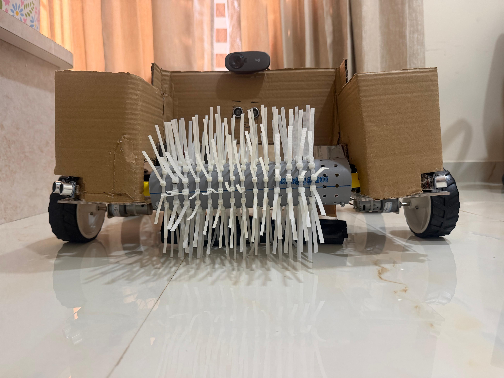

# Picker mechanism

The gripper is a section of PVC pipe driven by one DC motor through a BTS7960 driver. Zip ties attached to the pipe form the grip surface. The motor is switched fully on or off, with no speed control.

## Construction

| Property | Value |
|:---|:---|
| Pipe diameter and length | 6 cm and 27 cm |
| Motor attachment | 3D-printed shaft coupling, see [`cad/`](cad/) Screwed onto the DC Motor|
| Grip surface | Zip ties |
| Driver | BTS7960 on Pi pins 38 (RPWM) and 40 (LPWM) |
| Handles | Lightweight plastic wrappers |
| Cannot handle | very small pieces of trash, very large pieces of trash |



## 3D-printed parts

| Part | Purpose | File |
|:---|:---|:---|
| Shaft coupling | Joins the motor shaft to the PVC pipe | [`cad/shaftprint.stl`](cad/shaftprint.stl) |
| Ramp hinges | Let the ramp pivot so picked items slide onto the robot | [`cad/hingepicker.stl`](cad/hingepicker.stl) |

Both parts were modeled in Fusion 360 and 3D printed.

## When it runs

The camera decides when to pick up. The ultrasonic sensors sit above the floor and cannot see trash on the ground, so they play no part in the trigger. The picker starts when either of these holds:

1. The target is centered in the frame (x between 220 and 420 px), its bounding box covers at least 65,000 px², and its bottom edge has reached the pickup line at 92% of the frame height.
2. A target was seen within the last 2.8 seconds and has just dropped out of the bottom of the frame, centered or nearly so. The camera cannot see items directly in front of the gripper, so losing a close target at the bottom edge is treated as the item being within reach.

## Pickup sequence

| Step | Action |
|:---:|:---|
| 1 | The picker motor starts. |
| 2 | The robot drives forward at 34% duty for up to 2 seconds. It stops early if an ultrasonic sensor reports an obstacle. |
| 3 | The picker keeps running until 5 seconds have passed in total. |
| 4 | The picker and wheels stop. |
| 5 | The robot reverses briefly at 20% duty for 0.35 seconds. |
| 6 | After a 0.6 second pause, the robot clears its target and resumes searching. |

## Testing the picker alone

Run the gripper without the rest of the robot:

```
python src/main.py picker
```

This spins the picker for 10 seconds and exits. Do it with the robot lifted or the gripper clear of your hands.

## Known issues

| Issue | Effect |
|:---|:---|
| Center sensor reads close trash as an obstacle (20 cm or less) | The robot backs away before the picker starts, which caused most failed pickups. |
| Clear or dark plastic is detected less reliably | The robot may not approach, or may lose the target. |
| Picker timing is fixed | It runs 5 seconds whether or not the item was caught. |

## Ramp

A hinged ramp lets the picker slide items onto the robot. The hinges are the 3D-printed parts listed above.

The ramp is made of acrylic sheet. It is 26 cm long and 4 cm wide. It is connected to the robot using the #D printed hinge as mentioned. The picker slides the item up the ramp as it turns. 
